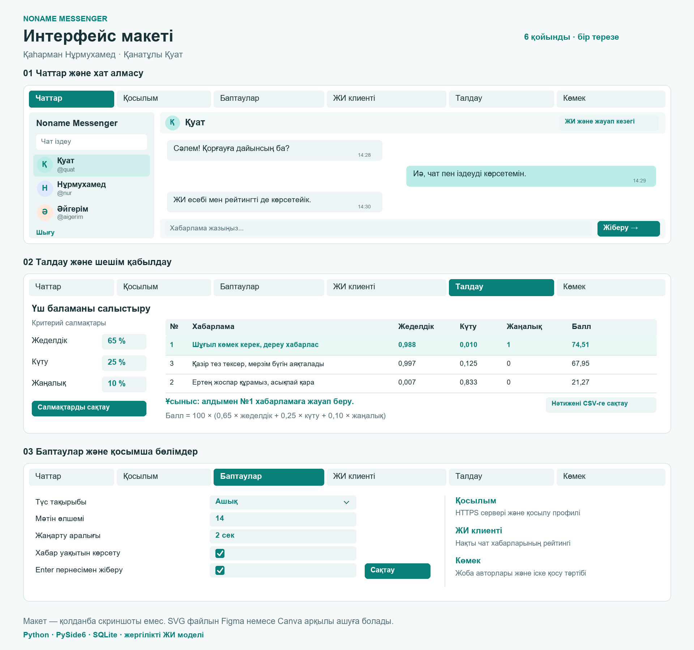
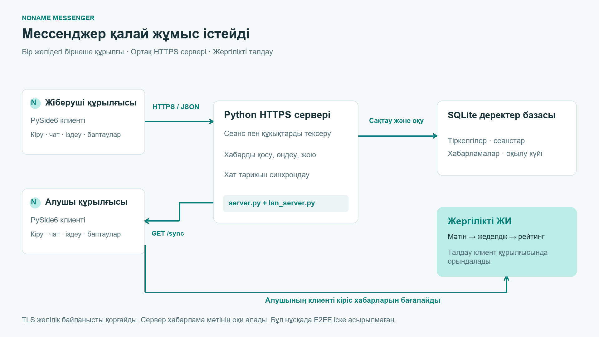
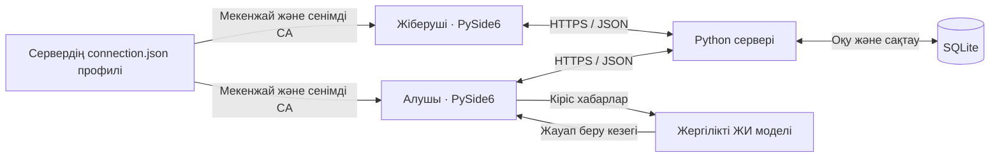
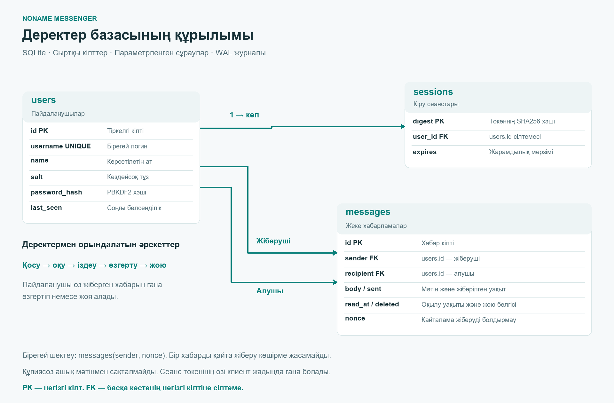
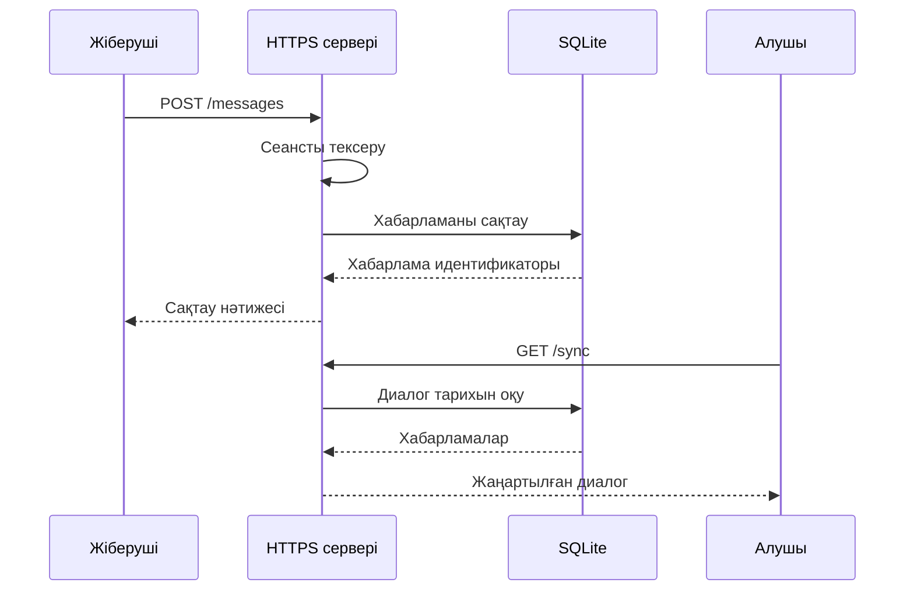

# Noname Messenger

Қазақ тіліндегі үстелдік мессенджер. Бір жергілікті желідегі бірнеше компьютер ортақ HTTPS серверіне қосылып, жеке хат алмасады. Қосымша Python, PySide6 және SQLite негізінде жасалған. Жергілікті ЖИ моделі кіріс хабарламаларына жауап беру кезегін ұсынады.

**Әзірлеушілер:** Қаһарман Нұрмухамед және Қанатұлы Қуат.

Жобаның мақсаты — студенттер мен шағын топтарға хат алмасуды, хат тарихын сақтауды және қай хабарламаға алдымен жауап беру керегін таңдауды бір қосымшада ұсыну.

## Тапсыру материалдары

- [Бағалау критерийлеріне сәйкестік](Criteria_KZ.md) — 13 талаптың коды мен дәлелі.
- [Жазбаша есеп](Project_Report_KZ.docx) — мақсат, құрылым, деректер базасы, әдіс, ЖИ, есептеулер және тексеру.
- [Қорғау презентациясы](Defense_KZ.pptx) және [қорғау нұсқаулығы](Defense_Guide_KZ.md).
- [Canva макеті](https://www.canva.com/design/DAHbo9FfGYQ/OMZp8FsMv39P0Fdf_BKoIQ/edit) және [өңделетін PPTX](Interface_Maket.pptx), [SVG](Interface_Maket.svg).
- [SQLite дерекқоры](Project_Database.sqlite3) және [SQL сызбасы](Database_Schema.sql) — жеке дерексіз бастапқы үш кесте.
- Python бастапқы коды, автоматтандырылған сынақтар және Windows іске қосу файлдары.

Бастапқы кодпен жұмыс істегенде алдымен Python орнатып, `setup.bat`, содан кейін `start_demo.bat` ашыңыз. Демо екі клиентті бір компьютерде іске қосады. Бірнеше компьютерге арналған тәртіп төменде берілген.

Егер жергілікті дайын жинақта `.python` және `.runtime` бумалары бар болса, орнату қадамын өткізіп, бірден `start_demo.bat` аша аласыз. Іске қосу файлдары сол жинақтағы Python мен кітапханаларды қолданады. GitHub-та бастапқы код пен тапсыру материалдары берілген; көлемді іске қосу ортасы репозиторийге кірмейді.

## Қосымшаның көрінісі

Негізгі бөлімдер бір терезедегі алты қойындыға бөлінген.


Чатта пайдаланушыны немесе хабар мәтінін іздеуге, хабар жіберуге және өз хабарыңызды өңдеуге не жоюға болады.

| Қойынды | Мүмкіндігі |
| --- | --- |
| Чаттар | Сұхбаттасушыны таңдау, іздеу және хат алмасу |
| Қосылым | Сервер мекенжайы, байланысты тексеру және мекенжайды көшіру |
| Баптаулар | Тақырып, мәтін өлшемі, жаңарту аралығы, уақыт белгісі және Enter арқылы жіберу |
| ЖИ клиенті | Ашық диалогтағы кіріс хабарлардың басымдық кестесі |
| Талдау | Үш баламаны салыстыру, салмақтарды өзгерту, есептеу үлестері және ЖИ бағалауы |
| Көмек | Мақсат, авторлар, пайдалану тәртібі, құпиялылық және қорғауда көрсету реті |

| Тіркелгіге кіру | ЖИ және жауап беру кезегі |
| --- | --- |
|  |  |

### Жоспарлау және дизайн



Бұл сурет — макет. Үш беттен тұратын өңделетін нұсқа Canva жобасына импортталған. PPTX файлындағы мәтіндер мен пішіндер жеке өңделеді. SVG файлын Figma ішінде де ашуға болады.

## Бірнеше компьютерде іске қосу

Барлық компьютерді бір Wi-Fi немесе жергілікті желіге қосыңыз. Әрқайсысына Python 3.10 немесе жаңарақ нұсқасын және жоба файлдарын орнатып, жоба бумасында мына пәрменді орындаңыз.

```powershell
python -m pip install -r requirements.txt
```

### Сервер болатын компьютер

1. Windows терминалында `ipconfig` орындап, белсенді Wi-Fi немесе Ethernet адаптерінің IPv4 мекенжайын табыңыз.
2. `start_server.bat` файлын ашып, сол мекенжайды енгізіңіз. Мысалы, `192.168.1.20`.
3. Терезені ашық қалдырыңыз. Қалған құрылғылар осы серверге қосылады.
4. Жасалған `data/network/connection.json` файлын серверді пайдаланатын компьютерлерге сенімді жолмен жіберіңіз.

Серверді пәрмен арқылы да іске қосуға болады. Мысалдағы мекенжайды өз компьютеріңіздің нақты IPv4 мекенжайымен ауыстырыңыз.

```powershell
python lan_server.py --address 192.168.1.20
```

Сервер деректерді `data/messages.sqlite3` базасына сақтайды. Әдепкі порт — `8765`. Қосылу профилінде сервер мекенжайы мен ашық CA сертификаты болады. `server.key` сервер компьютерінде қалады. Профильді сервер иесінен тікелей алыңыз, өйткені клиент сол файлдағы сертификатқа сенеді.

### Әр клиент компьютер

1. `start_client.bat` файлын ашыңыз немесе `python client.py` орындаңыз.
2. Кіру терезесінде **Қосылу профилін ашу** батырмасын басып, серверден алынған `connection.json` файлын таңдаңыз.
3. **Байланысты тексеру** арқылы серверге қолжетімділікті тексеріңіз.
4. **Тіркелу** арқылы жеке тіркелгі ашыңыз немесе бұрынғы тіркелгімен кіріңіз.
5. **Чаттар** қойындысынан сұхбаттасушыны таңдап, хабар жіберіңіз.

Бір тіркелгіге бірнеше компьютерден қатар кіруге болады. Бір клиенттен шығу басқа клиенттің сеансын аяқтамайды. Бір компьютерде өңделген немесе жойылған хабар басқа клиенттердің келесі жаңартуында көрінеді.

Профильді пәрменмен көрсетуге де болады.

```powershell
python client.py --profile connection.json
```

### Қосылымды тексеру

Клиент қосылмаса, сервердің ашық тұрғанын, профильдегі мекенжайды және компьютерлердің бір желіде екенін тексеріңіз. Windows брандмауэрі сервер портына кіріс қосылымды шектеуі мүмкін. Желі әкімшісімен осы порттың қолжетімділігін тексеріңіз. Қонақ Wi-Fi желісінде құрылғылар бір-бірінен оқшаулануы мүмкін.

Сервердің IPv4 мекенжайы өзгерсе, жаңа сертификат бумасын жасап, жаңа профильді клиенттерге таратыңыз. Дерекқор жолы өзгермесе, хат тарихы сақталады.

```powershell
python lan_server.py --address 192.168.1.25 --config-dir data/network-new
```

Бұл нұсқа Python және PySide6 орнатылған үстелдік компьютерлерге арналған. Интернет арқылы қосылу үшін клиенттерге қолжетімді HTTPS серверін бөлек орналастыру қажет.

## Бір компьютердегі демо

```powershell
python demo.py
```

`start_demo.bat` файлы да осы демоны ашады. Екі терезеде бөлек тіркелгі жасап, хабар алмасуды тексеріңіз. Демо `data/demo.sqlite3` базасын қолданады. Жергілікті желі сервері `data/messages.sqlite3` базасын қолданады, сондықтан олардың тіркелгілері мен тарихы бөлек сақталады.

## Құрылымы





- `client.py` — қойындылар, кіру, чат, іздеу және рейтинг интерфейсі.
- `api.py` — JSON сұраулары мен TLS сертификатын тексеру.
- `lan_server.py` — HTTPS серверін іске қосу және қосылу профилін жасау.
- `network_config.py` — импортталған профильдің пішімін тексеру.
- `server.py` — тіркелгі, сеанс, диалогқа қолжетімділік және SQLite.
- `decision.py` — аңғал Байес моделі және жауап беру рейтингі.

## Деректер базасы



`users` тіркелгілерді, `sessions` сеанс токендерінің SHA-256 дайджестін, `messages` хаттарды сақтайды. Құпиясөздер жеке тұзбен PBKDF2-HMAC-SHA256 арқылы хэштеледі. SQL сұрауларында параметрлер пайдаланылады. Хабар авторы ғана өз хабарын өңдейді немесе жояды. Жою кезінде мәтін тазаланып, `deleted=1` белгіленеді.

Қосымшада CRUD мына әрекеттермен орындалады: **Жіберу → хатты қарау → іздеу → Өңдеу → Жою**. Қайта кіргенде сақталған тарих сервер базасынан оқылады. **Тарихты сақтау** батырмасы ашық диалогты CSV файлына шығарады.

`Project_Database.sqlite3` — бос бастапқы база, онда пайдаланушылар, сеанстар немесе жеке хаттар жоқ. Нақты іске қосылған сервер өзінің `data/` бумасындағы базасын пайдаланады. Тапсырылатын базаны қайта жасау үшін бұрын жоқ файл атауын таңдаңыз:

```powershell
python prepare_database.py --output my_project.sqlite3 --schema my_schema.sql
```

## Хабарлама қалай жеткізіледі



Клиент серверден жаңартуларды белгіленген аралықпен сұрайды. Аралық **Баптаулар** қойындысында өзгертіледі. TLS клиент пен сервер арасындағы байланысты қорғайды. Сервер хаттарды сақтау және жеткізу үшін олардың мәтінін оқи алады.

## ЖИ рейтингі

Модель қазақша мәтінге жеделдік бағасын береді. Қосымша осы бағаны күту уақыты және хабардың жаңалығымен біріктіріп, ең жоғары балл алған хабарды бірінші ұсынады.

```text
Балл = 100 × (0,65 × жеделдік + 0,25 × күту + 0,10 × жаңалық)
```

Мәтін жергілікті клиентте талданады. Бағаға әсер еткен сөздер интерфейсте көрсетіледі. Шағын оқу моделінің ұсынысын пайдаланушы тексеріп, соңғы шешімді өзі қабылдайды.

### Шешім қабылдау әдісі және үш нұсқа

**Салмақталған қосынды әдісі** үш өлшемді 0–1 аралығына келтіріп салыстырады: жеделдік ықтималдығы; `min(күту сағаты / 24, 1)`; соңғы сағатта келсе 1 болатын жаңалық. Салмақтар теріс болмауы керек және олардың қосындысы нөлден үлкен болуы қажет. Қосымша енгізілген салмақтарды қосындысына бөліп, 1-ге келтіреді.

**Талдау → Демо есептеу** үш жасанды хабарламаны салыстырады. Әдепкі салмақтар: 0,65; 0,25; 0,10.

| Хабарлама | Жеделдік | Күту | Жаңалық | Балл |
| --- | ---: | ---: | ---: | ---: |
| №1 | 0,988479 | 0,010417 | 1 | 74,51 |
| №3 | 0,997358 | 0,125000 | 0 | 67,95 |
| №2 | 0,006781 | 0,833333 | 0 | 21,27 |

Бірінші №1 ұсынылады. №1 үшін есеп: `100 × (0,65 × 0,988479 + 0,25 × 0,010417 + 0,10 × 1) = 74,51`. Жеделдікке ғана салмақ берсеңіз, №3; күтуге ғана салмақ берсеңіз, №2 бірінші болады. Бұл таңдаудың пайдаланушы қойған басымдыққа тәуелді екенін көрсетеді.

Нақты диалогқа есеп **ЖИ клиенті** қойындысында жасалады. Жолды таңдағанда толық мәтін, тірек сөздер және әр критерийдің баллға қосқан үлесі көрсетіледі. **CSV есебін сақтау** батырмасы рейтингті салмақтарымен бірге экспорттайды.

### ЖИ моделі қалай тексеріледі

Мультиномиалды аңғал Байес моделі 24 қазақша оқу мысалынан сөз жиіліктерін үйренеді; Лаплас тегістеуі қолданылады. Оқытуға кірмейтін 16 бақылау сөйлемінің 16-сы дұрыс жіктелді. Бұл шағын, қолмен жасалған оқу жиынының нәтижесі; шынайы хаттардағы дәлдік көрсеткіші ретінде қолдануға болмайды. Белгісіз сөздер бейтарап баға береді, күрделі контекст пен терістеу қате бағалануы мүмкін.

## Тестілеу

```powershell
python -m unittest -v
```

`run_tests.bat` осы сынақтарды орындайды. Автоматтандырылған сынақтар тіркелгіні, хабар алмасуды, авторлық өңдеу мен жоюды, тарихтың сақталуын, ЖИ рейтингін және TLS тексеруін қамтиды. HTTPS сынақтарында бір тіркелгінің екі тәуелсіз сеансы және басқа пайдаланушының клиенті қатар жұмыс істейді. Бұл желілік сынақтар бір компьютердегі бөлек клиенттермен орындалды. Екі физикалық компьютер арасындағы қосылымды өз желіңізде тексеріңіз.

26 автоматтандырылған сынақ өтті. Бұған қоса PySide6 интерфейсінің жеке тексеруі HTTPS қосылымын, екі клиенттегі хат алмасуды, алты қойындыны, CSV файлдарын қайта оқуды, салмақ өзгергенде ұсыныстың ауысуын, нөлдік салмақтарды қабылдамауды және баптаулардың сақталуын тексерді. Суреттер осы жаңартылған интерфейстен алынған.

Интерфейсті бөлек тексеру:

```powershell
python gui_smoke_test.py
```

Тексеру уақытша дерекқор мен жасанды тіркелгілерді пайдаланады. Графикалық орта қажет. Жергілікті `.runtime` бумасы немесе `NONAME_QA_DEPS` айнымалысы арқылы бөлек орнатылған тәуелділіктерді көрсетуге болады.

