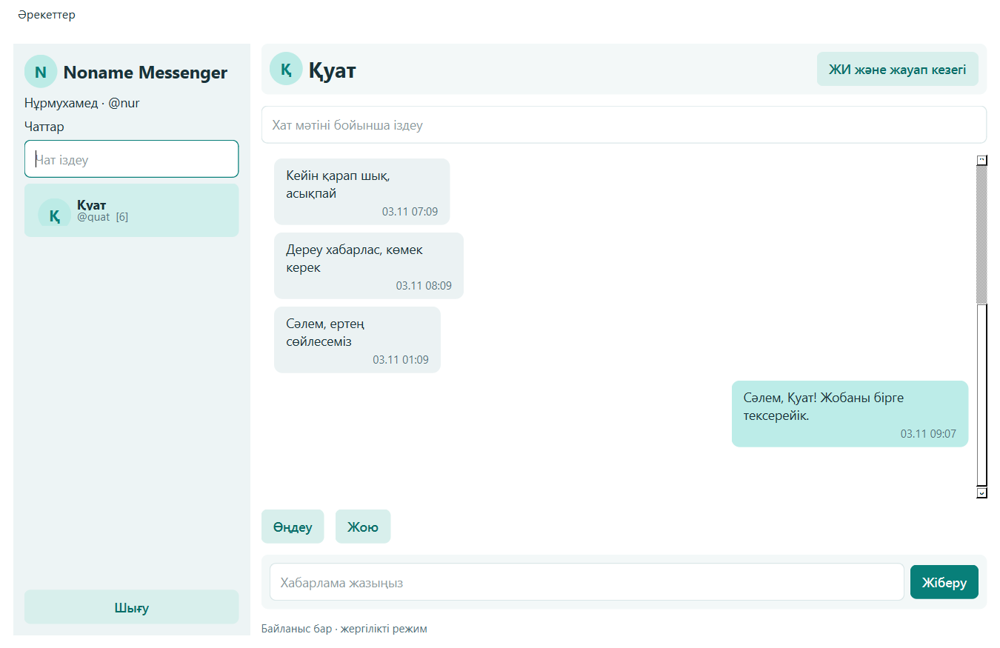
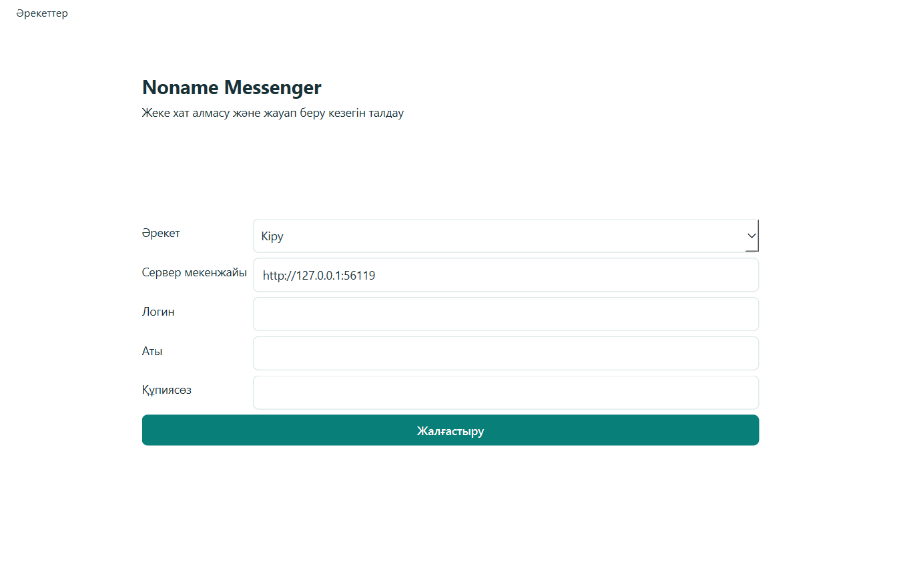
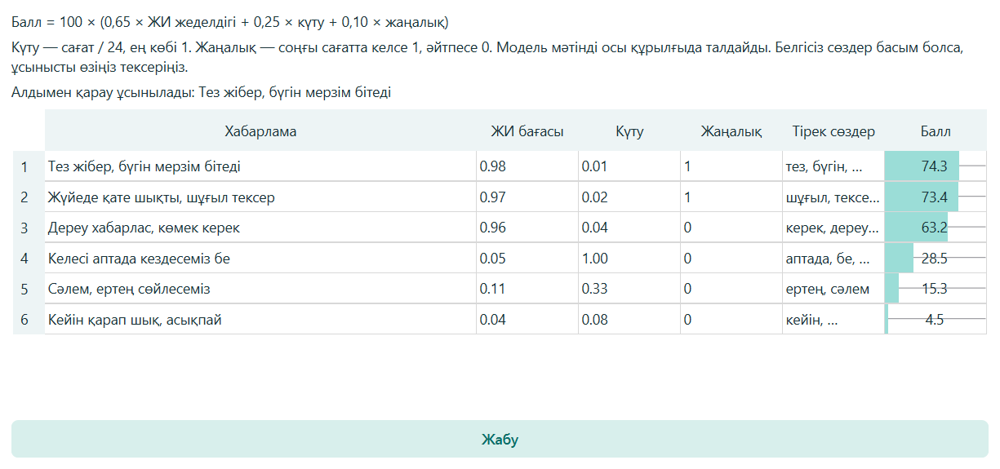
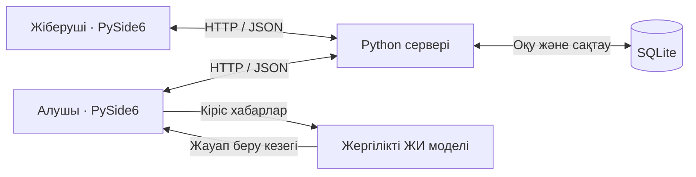
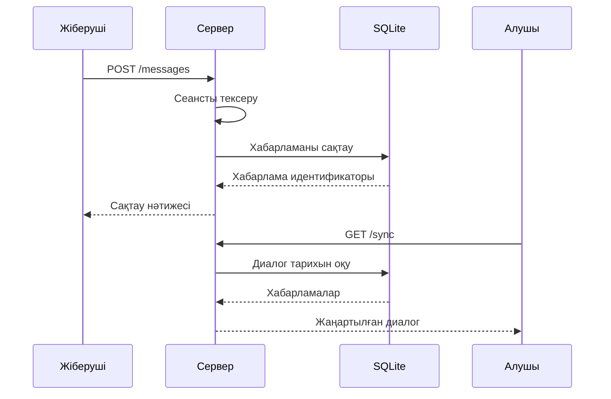

# Noname Messenger

Қазақ тіліндегі үстелдік мессенджер. Python, PySide6 және SQLite негізінде жасалған. Пайдаланушылар жеке хат алмаса алады, ал ЖИ кіріс хабарламаларына жауап беру кезегін ұсынады.

## Қосымшаның көрінісі



Чатта пайдаланушыны немесе хабар мәтінін іздеуге, хабар жіберуге және өз хабарыңызды өңдеуге не жоюға болады.

| Тіркелгіге кіру | ЖИ және жауап беру кезегі |
| --- | --- |
|  |  |

## Құрылымы



- `client.py` — кіру, чат, іздеу, баптаулар және рейтинг терезелері.
- `api.py` — клиент пен сервер арасындағы JSON сұраулары.
- `server.py` — тіркелгі, сеанс және диалогқа қолжетімділік. SQLite базасында пайдаланушылар, сеанстар және хабарламалар сақталады.
- `decision.py` — жеделдікті бағалайтын аңғал Байес моделі және жауап беру рейтингі.

## Хабарлама қалай жеткізіледі



Клиент серверден жаңартуларды белгілі бір аралықпен сұрайды. Аралықты **Әрекеттер → Баптаулар** мәзірінен өзгертуге болады. Сол жерде тақырып, мәтін өлшемі, хабар уақыты және Enter арқылы жіберу де бапталады.

## ЖИ рейтингті қалай есептейді

Модель қазақша хабар мәтініне жеделдік бағасын береді. Қосымша осы бағаны күту уақыты және хабардың жаңалығымен біріктіріп, ең жоғары балл алған хабарды бірінші ұсынады.

```text
Балл = 100 × (0,65 × жеделдік + 0,25 × күту + 0,10 × жаңалық)
```

Мәтін жергілікті клиентте талданады. Сервер хаттарды сақтау және жеткізу үшін олардың мәтінін оқи алады.

## Іске қосу

Python 3.10 немесе жаңарақ нұсқасын қолданыңыз.

```powershell
python -m pip install -r requirements.txt
python demo.py
```

Windows жүйесінде тәуелділіктерді орнатқан соң `start_demo.bat` файлын да ашуға болады. Демо бір компьютерде жергілікті серверді және екі клиентті іске қосады. Әр терезеде **Тіркелу** арқылы бөлек тіркелгі ашыңыз. Бір-біріңізді іздеп, хабар алмасыңыз. Дерекқор бірінші іске қосылғанда `data/` бумасында жасалады.

## Тестілеу

```powershell
python -m unittest -v
```
